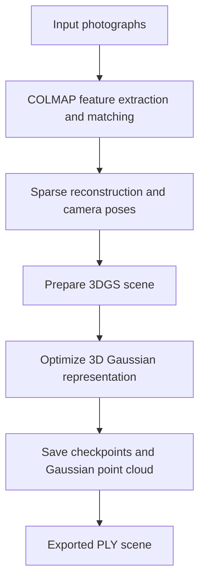

# Gaussian_Splatting
An end-to-end 3D Gaussian Splatting pipeline for reconstructing 3D scenes from photographs using COLMAP and GPU-accelerated optimization.

**A Google Colab workflow for reconstructing a 3D scene with 3D Gaussian Splatting**

Reconstruct a scene from a small collection of photographs using COLMAP for camera poses and sparse geometry, then optimize a 3D Gaussian representation and export a `.ply` point-cloud-style scene.

[Notebook](./Gaussian_splatting.ipynb) · [Original 3D Gaussian Splatting paper](https://repo-sam.inria.fr/fungraph/3d-gaussian-splatting/)

</div>

---

## Overview

This repository documents a practical end-to-end experiment with **3D Gaussian Splatting (3DGS)**. Starting from ordinary photographs, the notebook prepares the scene, estimates camera poses with COLMAP, trains the Gaussian representation, and saves the resulting scene as a PLY file.

The goal is to make the reconstruction workflow understandable and reproducible—not to introduce a new Gaussian Splatting algorithm. The implementation is based on an external 3DGS repository, with notebook cells that prepare the environment and run the pipeline in Google Colab.

## Pipeline



### Main stages

1. **Load photographs** from Google Drive and copy them into the scene's `input/` directory.
2. **Estimate camera poses with COLMAP.** The notebook checks that the sparse reconstruction exists and reports how many images were registered.
3. **Prepare the 3DGS environment**, including the required Python/PyTorch and CUDA-related components.
4. **Train the scene** for 30,000 iterations, saving intermediate checkpoints and Gaussian representations.
5. **Export the result** as a `.ply` file for inspection in a compatible 3D viewer.

## Experimental run

The following values are taken from the saved notebook output.

| Item | Recorded result |
|---|---|
| Input photographs | 10 |
| Images registered by COLMAP | 10 / 10 |
| Training iterations | 30,000 |
| Training duration | Approximately 1 hour 42 minutes |
| Initial Gaussian count reported by training | 3,216 |
| Final training L1 | 0.01130 |
| Final training PSNR | 33.23 dB |
| Exported PLY size | Approximately 502 MB |

**How to interpret these numbers:** the reported L1 and PSNR are training metrics printed by this run. They are not a benchmark against other methods, and they do not by themselves establish novel-view quality or generalization. Runtime depends on the GPU, image resolution, and environment.

## Getting started

### Requirements

- A Google account with Google Colab access
- Google Drive to store input images and output files
- A set of overlapping photographs of the same static scene
- Sufficient GPU memory and Drive storage for training and the generated PLY

The notebook uses an older, version-sensitive environment (including Python 3.7 and PyTorch 1.12.1 with CUDA 11.6 wheels, alongside a CUDA 11.8 toolkit setup). Google Colab's default runtime can change, so **the environment cells may require maintenance before they work in a fresh session**. The saved notebook records a successful run, but that does not guarantee that the same setup will run unchanged today.

### Run the notebook

1. Open `Gaussian_splatting.ipynb` in Google Colab.
2. Put your scene photographs in a folder named `images` in the root of your Google Drive, or update `IMAGES_DIR` in the notebook.
3. Run the cells in order. When prompted, authorize Google Drive access.
4. Check the COLMAP registration result. The notebook stops if the expected sparse reconstruction file is missing.
5. Run training and wait for the configured 30,000 iterations to finish.
6. Find the output PLY at:

   ```text
   MyDrive/gs_output/myscene/point_cloud/iteration_30000/point_cloud.ply
   ```

### Photographing a scene

For more reliable camera registration, aim for:

- Strong overlap between neighboring views
- A slow, continuous walk around the subject
- Sharp images with consistent exposure
- Visible texture and detail across the scene
- A mostly static scene during capture

Reflective, transparent, textureless, or moving objects can make camera estimation and reconstruction difficult.

## Repository contents

```text
.
├── Gaussian_splatting.ipynb   # End-to-end Colab workflow
└── README.md                  # Project overview and instructions
```

The trained PLY is generated in Google Drive and is **not automatically included** in this repository. It is large (about 502 MB in the recorded run), so consider linking to a hosted result or providing a small preview instead of committing the full artifact.

## Limitations and next steps

- **Environment reproducibility:** simplify and modernize the CUDA/PyTorch setup, and document a tested runtime.
- **Visual evaluation:** add rendered novel-view screenshots or a short turntable video.
- **Quantitative evaluation:** report held-out-view metrics separately from training metrics.
- **Capture quality:** compare how image overlap, blur, lighting, and texture affect COLMAP registration and the final scene.
- **Packaging:** add a concise environment specification and a small sample scene if licensing and storage permit.

## Acknowledgements

This notebook uses the 3D Gaussian Splatting implementation from the [GraphDeco / INRIA project](https://github.com/graphdeco-inria/gaussian-splatting) and relies on [COLMAP](https://colmap.github.io/) for camera pose estimation and sparse reconstruction. Please consult the original repositories and papers for their licensing, citation, and usage requirements.

## Citation

If you use the underlying method in academic work, cite the original 3D Gaussian Splatting paper:

> Kerbl, B., Kopanas, G., Leimkühler, T., & Drettakis, G. (2023). *3D Gaussian Splatting for Real-Time Radiance Field Rendering*. ACM Transactions on Graphics.

Project page: https://repo-sam.inria.fr/fungraph/3d-gaussian-splatting/

---

<div align="center">

**A hands-on exploration of image-based 3D reconstruction and real-time scene representations.**

</div>
