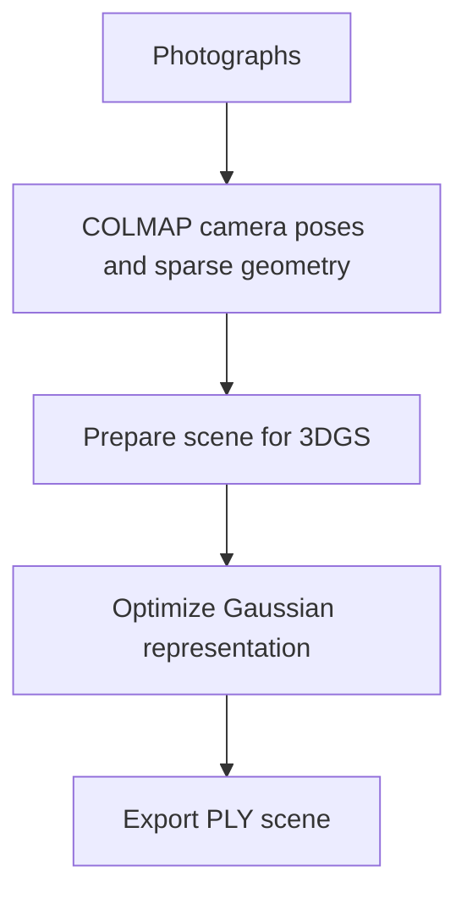

# Gaussian_Splatting
An end-to-end 3D Gaussian Splatting pipeline for reconstructing 3D scenes from photographs using COLMAP and GPU-accelerated optimization.

# 3D Gaussian Splatting — From Images to a 3D Scene

**A Google Colab workflow for reconstructing a 3D scene from photographs**

[Open the notebook](./Gaussian_Splatting_Public.ipynb) · [Original 3DGS paper](https://repo-sam.inria.fr/fungraph/3d-gaussian-splatting/)

## Overview

This project documents an end-to-end experiment using **3D Gaussian Splatting (3DGS)**. It takes photographs of a scene, estimates camera poses and sparse geometry with COLMAP, trains a Gaussian representation, and saves a `.ply` scene.

This is a practical workflow based on an existing 3DGS implementation, not a new implementation of the algorithm.

## Pipeline

## Run it

1. Open `Gaussian_Splatting_Public.ipynb` in Google Colab.
2. Choose a GPU runtime.
3. Put your JPG/JPEG/PNG images in a Google Drive folder.
4. In Section 2 of the notebook, set `IMAGES_DIR` to that folder.
5. Run the notebook cells in order.
6. The output is written under `MyDrive/gs_output/myscene/`.

## Experimental result from the original run

The saved run processed **10 input images**, registered all 10 with COLMAP, and completed **30,000 training iterations**. The recorded training PSNR was **33.23 dB** at iteration 30,000. These are run-specific training results, not a held-out benchmark or a guarantee of reconstruction quality.

## Important environment note

The notebook uses a legacy Python/PyTorch/CUDA setup because the original experiment was run with older dependencies. Google Colab's runtime changes over time, so a fresh run may require adapting the environment. Read the notes in the notebook before installing the legacy stack.

## Tips for input images

- Capture sharp images with substantial overlap between neighboring views.
- Keep the scene static while taking photos.
- Include texture and detail; textureless, reflective, or transparent objects can be difficult.
- Ensure there is enough GPU memory and Drive space for the training output.

## Credits

- [3D Gaussian Splatting implementation](https://github.com/graphdeco-inria/gaussian-splatting)
- [COLMAP](https://colmap.github.io/)
- Kerbl et al., *3D Gaussian Splatting for Real-Time Radiance Field Rendering* (2023): [project page](https://repo-sam.inria.fr/fungraph/3d-gaussian-splatting/)

Please check upstream licenses and citation requirements before redistribution or commercial use.

